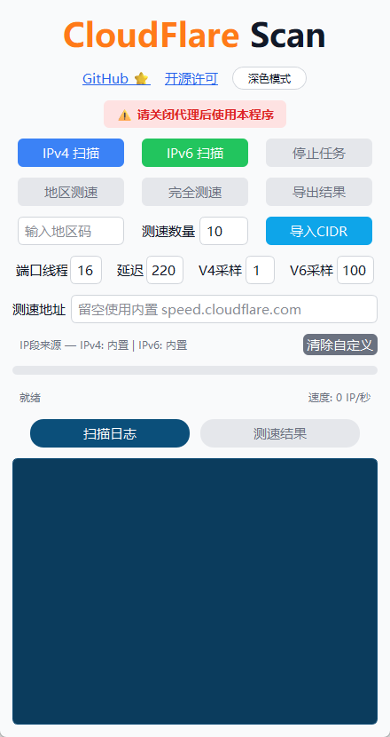
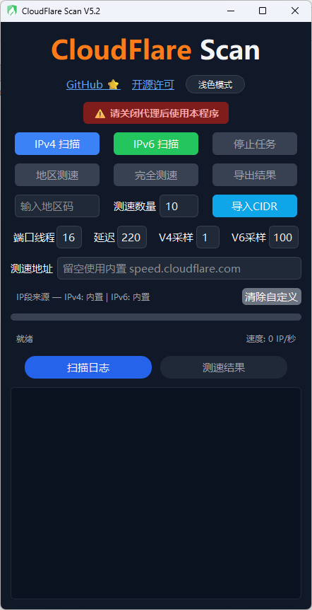

# CloudFlareScan (ipv4&ipv6)  

  
  
  

CloudFlareScan （简称CFS)  适配 Winows11 

  
  

⚠️免责声明：本工具仅供学习和合法网络测速，请遵守当地法律法规，造成的一切后果自负。

🚀 高效扫描：内置 CloudFlare 官方 CIDR 段生成 IP 地址 还可以导入自定义TXT格式的CIDR文件覆盖内置

📊 双模式测速：完全测速 + 地区测速，满足不同需求

🌍 全球覆盖：内置全球大部分机场IATA代码映射，自动识别地区

⚡ 异步处理：支持高并发测试，快速获取结果

📋 一键复制：双击表格单元格即可复制内容

📈 实时统计：显示扫描进度、速度

使用方法：

CloudFlareScan-Windows.zip 直接下载使用

